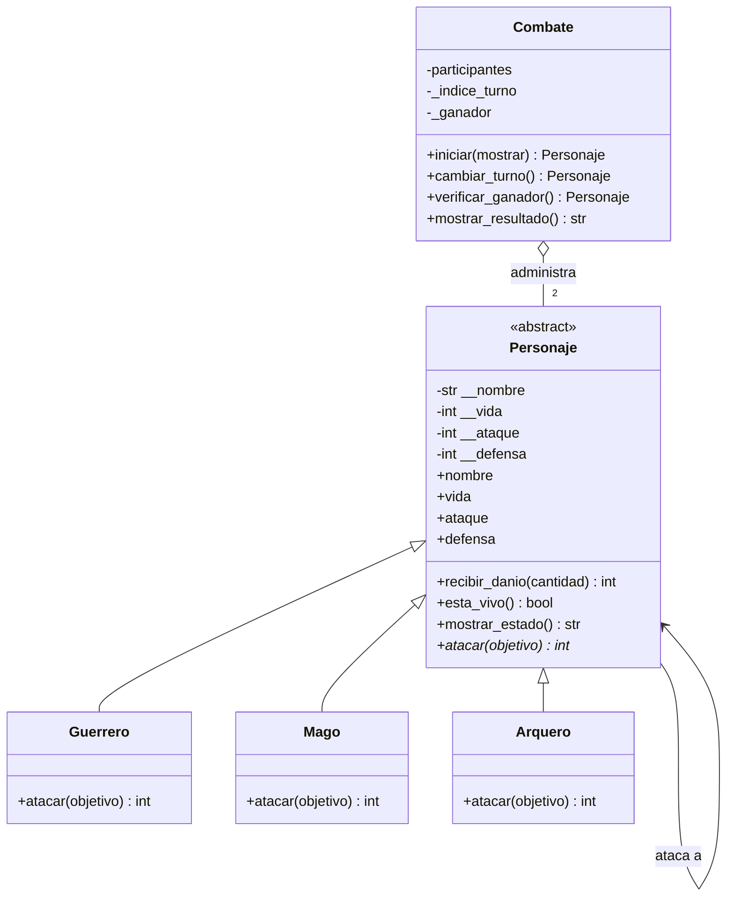

# Guardians of the Ancient Kingdom

**Proyecto integrador — Sistema de combate por turnos**

**Estudiante:** Martín Alejandro Castro Berdugo  
**Asignatura:** Programación Orientada a Objetos con Python

## 1. Descripción

Guardians of the Ancient Kingdom es un sistema de combate por turnos entre guardianes de tres clases: Guerrero, Mago y Arquero. Cada personaje tiene nombre, vida, ataque y defensa. El programa calcula el daño según las habilidades de cada clase, actualiza la vida de los participantes y determina si hay un ganador o si el combate termina en empate técnico o por límite de rondas.

## 2. Requisitos

- Python 3.10 o superior.
- Pytest para ejecutar las pruebas automatizadas (opcional para ejecutar la demostración).

## 3. Estructura del proyecto

- `personajes.py`: contiene las clases `Personaje`, `Guerrero`, `Mago`, `Arquero` y `Combate`. Incluye validaciones, propiedades, ataques y administración de turnos.
- `main.py`: ejecuta una demostración de combate y pruebas manuales.
- `test_personajes.py`: contiene las pruebas automatizadas con Pytest.
- `README.md`: contiene la documentación del proyecto y el diagrama de clases UML.

## 4. Responsabilidad de las clases

- **`Personaje`:** clase abstracta que centraliza los atributos y comportamientos compartidos. Protege sus datos mediante propiedades y valida las asignaciones.
- **`Guerrero`:** potencia el ataque un 20 %, redondea hacia abajo el ataque potenciado y resta la defensa del objetivo.
- **`Mago`:** inflige un daño igual a su ataque, sin descontar la defensa del objetivo.
- **`Arquero`:** si su ataque supera la defensa enemiga, duplica la diferencia; de lo contrario, causa cero daño.
- **`Combate`:** recibe dos personajes creados previamente, alterna sus turnos, muestra los estados y determina el resultado. No necesita comprobar la clase concreta del atacante para ejecutar su método `atacar()`.

## 5. Diagrama de clases UML



El triángulo de herencia indica que cada guardián es un tipo de `Personaje`. El rombo abierto en `Combate` representa la agregación: el combate administra personajes creados de manera independiente. La flecha de `Personaje` hacia sí misma representa la interacción entre el atacante y el objetivo.

## 6. Relaciones entre clases

- **Herencia:** `Guerrero`, `Mago` y `Arquero` heredan los atributos y métodos comunes de `Personaje`.
- **Asociación:** durante un ataque, un personaje interactúa con otro al invocar su método `recibir_danio()`.
- **Agregación:** `Combate` recibe dos objetos ya creados y los coordina; no necesita crearlos dentro de su constructor.

## 7. Conceptos de programación orientada a objetos aplicados

- **Abstracción:** `Personaje` representa las características y comportamientos comunes de los guardianes. Es una clase abstracta y no se puede instanciar directamente.
- **Encapsulamiento:** los atributos se almacenan como atributos privados (`__nombre`, `__vida`, `__ataque` y `__defensa`). Se accede a ellos mediante propiedades que validan los datos.
- **Herencia:** las tres clases concretas reutilizan la estructura común de `Personaje`.
- **Polimorfismo:** `Combate` llama a `atacar()` sin comprobar qué clase concreta tiene cada participante. Python ejecuta la implementación correspondiente al tipo de objeto.
- **Validaciones y excepciones:** el sistema rechaza nombres vacíos, tipos de datos incorrectos y valores fuera de los rangos establecidos.

## 8. Lógica del combate

Cada ronda da una oportunidad de ataque a cada participante mientras ambos sigan vivos. Después de cada ataque se muestra el estado actualizado de los personajes.

El combate termina cuando queda un único personaje vivo, cuando una ronda completa causa cero daño o cuando se alcanza el límite de 50 rondas.

El método `recibir_danio()` limita el daño aplicado a la vida restante y devuelve el daño efectivo. De esta manera, la vida no puede ser negativa.

### Fórmulas de daño

- **Guerrero:** `max(0, floor(ataque * 1.20) - defensa_objetivo)`.
- **Mago:** `ataque`.
- **Arquero:** si `ataque > defensa_objetivo`, el daño es `(ataque - defensa_objetivo) * 2`; de lo contrario, es `0`.

## 9. Ejecución del programa

Desde la terminal, dentro de la carpeta del proyecto, ejecuta:

```bash
python main.py
```

Para instalar Pytest, si no está disponible:

```bash
python -m pip install pytest
```

Para ejecutar las pruebas automatizadas:

```bash
python -m pytest -v
```

## 10. Pruebas y resultados

Las pruebas automatizadas comprueban la creación de personajes, el rechazo de datos inválidos, las habilidades de ataque de las tres clases, la vida no negativa, el bloqueo de ataques de personajes derrotados, la validación de objetivos, la determinación del ganador y el empate técnico por ausencia de daño.

En la ejecución realizada con `python -m pytest -v`, las **21 pruebas automatizadas finalizaron correctamente**.

**Resultado:** `21 passed in 0.08s`.

## 11. Reto de abstracción

El método `atacar()` debe ser abstracto porque todos los personajes tienen la capacidad de atacar, pero la manera de hacerlo cambia según su especialidad.

El Guerrero potencia su ataque y resta la defensa del objetivo; el Mago ignora la defensa; y el Arquero duplica el daño base únicamente cuando su ataque supera la defensa enemiga. Si la clase base proporcionara una única implementación de `atacar()`, obligaría a todos los personajes a compartir una regla que no representa sus habilidades específicas.

Por eso, el decorador `@abstractmethod` exige que cada subclase implemente su propia versión del método. Esto también permite que `Combate` invoque `atacar()` de manera polimórfica.

En cambio, `recibir_danio()` sí puede implementarse en `Personaje`, porque la regla para recibir daño es común a todas las clases: validar que la cantidad no sea negativa, descontar como máximo la vida disponible y evitar que la vida baje de cero.

El daño llega calculado desde el método de ataque, por lo que `recibir_danio()` no vuelve a descontar la defensa. Así se reutiliza una única regla general y se evita duplicar código en las tres clases.

## 12. Conclusión

El proyecto demuestra cómo organizar un programa mediante clases con responsabilidades definidas, validar el estado de los objetos y aplicar los principios de abstracción, encapsulamiento, herencia y polimorfismo.

Además, la separación entre las clases de personajes y la clase `Combate` facilita el mantenimiento y la ampliación del sistema. Para añadir una nueva clase de guardián, basta con heredar de `Personaje` e implementar el método `atacar()` sin necesidad de modificar la lógica central del combate.
