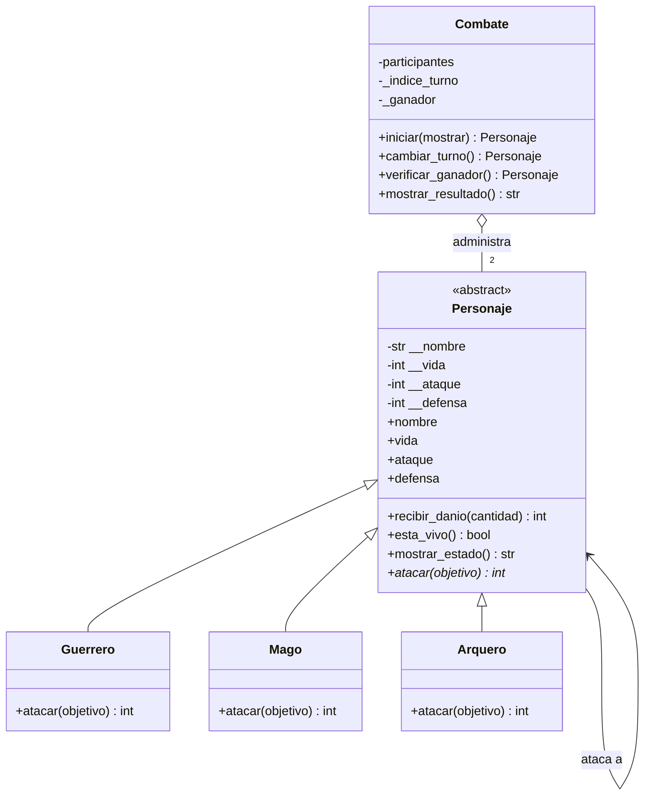

Guardians of the Ancient Kingdom
Proyecto integrador — Sistema de combate por turnos

Estudiante: Martín Alejandro Castro Berdugo
Asignatura: Programación Orientada a Objetos con Python
1. Descripción
Guardians of the Ancient Kingdom es un sistema de combate por turnos entre guardianes de tres clases: Guerrero, Mago y Arquero. Cada personaje tiene nombre, vida, ataque y defensa. El programa calcula los ataques según la habilidad de cada clase, actualiza la vida y determina si hay un ganador, empate técnico o empate por límite de rondas.
2. Requisitos
Python 3.10 o superior.
Pytest para ejecutar las pruebas automatizadas (opcional para ejecutar la demostración).
3. Estructura del proyecto
`personajes.py`: contiene `Personaje`, `Guerrero`, `Mago`, `Arquero` y `Combate`. Incluye validaciones, propiedades, ataques y administración de turnos.
`main.py`: ejecuta una demostración de combate y pruebas manuales.
`test_personajes.py`: pruebas automatizadas con Pytest.
`README.md`: documentación y diagrama de clases.
4. Responsabilidad de las clases
`Personaje`: clase abstracta que centraliza los atributos y comportamientos compartidos. Protege sus datos con propiedades y valida cada asignación.
`Guerrero`: potencia el ataque un 20 %, redondea hacia abajo el ataque potenciado y resta la defensa del objetivo.
`Mago`: inflige un daño igual a su ataque, sin descontar la defensa.
`Arquero`: si su ataque supera la defensa enemiga, duplica la diferencia; si no, causa cero daño.
`Combate`: recibe dos personajes ya creados, alterna sus turnos, muestra estados y determina el resultado. No necesita comprobar la clase concreta del atacante.
5. Diagrama de clases UML

El triángulo de herencia indica que cada guardián es un tipo de `Personaje`. El rombo abierto en `Combate` representa agregación: el combate administra personajes creados de manera independiente. La flecha de `Personaje` hacia sí misma representa la interacción entre atacante y objetivo.
6. Relaciones entre clases
Herencia: Guerrero, Mago y Arquero heredan los atributos y métodos comunes de `Personaje`.
Asociación: durante un ataque, un personaje interactúa con otro al invocar su método `recibir_danio()`.
Agregación: `Combate` recibe dos objetos ya creados y los coordina; no los crea como parte obligatoria de su constructor.
7. Conceptos de POO aplicados
Abstracción: `Personaje` representa lo que todos los guardianes tienen en común. Es abstracta y no se puede instanciar directamente.
Encapsulamiento: los atributos se almacenan como atributos privados (`__nombre`, `__vida`, `__ataque`, `__defensa`) y se accede a ellos mediante propiedades que validan los datos.
Herencia: las tres clases concretas reutilizan la estructura común de `Personaje`.
8. Lógica del combate: Polimorfismo: `Combate` llama a `atacar()` sin preguntar qué clase concreta tiene el participante; Python ejecuta la versión correspondiente.
Validaciones y excepciones: se rechazan nombres vacíos, tipos incorrectos y valores fuera de los rangos establecidos.
9. Lógica del combate
Cada ronda da una oportunidad de ataque a cada participante, mientras siga vivo. Después de cada ataque se muestra el estado actualizado. El combate termina cuando queda un único personaje vivo, cuando una ronda completa causa cero daño o al llegar a 50 rondas. `recibir_danio()` limita el daño aplicado a la vida restante y devuelve el daño efectivo, por lo que la vida no puede ser negativa.
Fórmulas
Guerrero: `max(0, floor(ataque * 1.20) - defensa_objetivo)`.
Mago: `ataque`.
Arquero: si `ataque > defensa_objetivo`, `(ataque - defensa_objetivo) * 2`; en caso contrario, `0`.
11. Ejecución
Desde la carpeta del proyecto:
```bash
python main.py
```
Para instalar Pytest si no está disponible:
```bash
python -m pip install pytest
```
Para ejecutar las pruebas automatizadas:
```bash
python -m pytest -v
```
10. Pruebas y resultados
Las pruebas comprueban la creación de personajes, rechazo de datos inválidos, habilidades de las tres clases, vida no negativa, bloqueo de ataques de personajes derrotados, objetivo inválido, ganador correcto y empate técnico sin daño.
Al ejecutar `python -m pytest -v`, Pytest muestra el estado individual de cada prueba y un resumen final. No se afirma un resultado de ejecución hasta que se ejecute en el equipo o entorno correspondiente.
11. Reto de abstracción
`atacar()` debe ser abstracto porque todos los personajes tienen la capacidad de atacar, pero la manera de hacerlo cambia según su especialidad. El Guerrero potencia su ataque y resta la defensa; el Mago ignora la defensa; y el Arquero duplica el daño base solo cuando su ataque supera la defensa. Si la clase base proporcionara una única implementación de `atacar()`, obligaría a todos a compartir una regla que no representa sus habilidades. Por eso `@abstractmethod` exige que cada subclase defina su propia versión y permite que `Combate` llame a `atacar()` de forma polimórfica.
En cambio, `recibir_danio()` sí puede implementarse en `Personaje` porque la regla de recibir daño es común: validar que no sea negativo, descontar como máximo la vida disponible y evitar que la vida baje de cero. El daño ya llega calculado desde el ataque, así que este método no vuelve a descontar la defensa. Así se reutiliza una única regla general y se evita duplicar código en las tres clases.
12. Conclusión
El proyecto muestra cómo organizar un programa con clases responsables, validar el estado de los objetos y extender el sistema mediante herencia y polimorfismo. Para añadir otra clase de guardián, se puede heredar de `Personaje` e implementar `atacar()` sin cambiar la lógica central de `Combate`.
